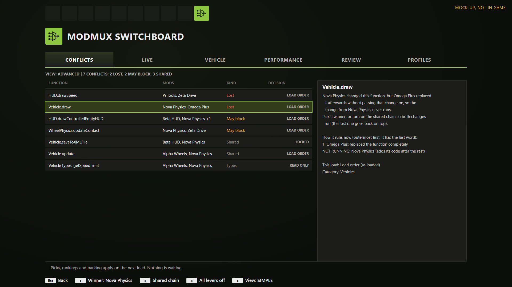

<p align="center">
  <a href="https://github.com/DTM-Mods"></a>
</p>

<p align="center">
  
</p>

<h1 align="center">ModMux</h1>

<p align="center">
  
  <a href="https://github.com/DTM-Mods/FS25_ModMux/releases/latest"></a>
  <a href="https://github.com/DTM-Mods"></a>
</p>

<p align="center">
  <b>Shows where your mods collide inside the game, and lets you decide who wins.</b><br>
  <sub>by Fennell</sub>
</p>

<p align="center">
  
</p>

Say one mod makes tyres grip better in mud and another adds a wheel wear system. Both hook into the game's wheel code.
Farming Simulator doesn't referee that: whichever mod is loaded later decides, and depending on how it was written the
other mod's code may never run again. Nothing tells you; you only notice that a feature you installed does nothing.

ModMux reads how every mod has hooked into the game, finds the spots where two or more of them meet, and shows you
what happens at each one. Then you decide.

<p align="center">
  
  <sub>Mock-up drawn from ModMux's real page data with test mods, not an in-game screenshot. More in <a href="previews/">previews/</a>.</sub>
</p>

### Using it

1. Load your savegame as usual.
2. Open the **ESC menu** and go to the **ModMux** page (its tab shows a switch symbol).
3. On **CONFLICTS**, every spot where mods meet is listed. Select one and the right side explains it: which mods are
   involved, in what order they run, and whether one of them cut another off.
4. Decide what should happen (see below).
5. Save and restart. Your decisions take effect at the next load, never in the middle of a session.

### What you can decide

- **One mod gets its way**: pick a winner for a single function. Only that mod's hook stays; the others are switched
  off there (and only there).
- **Both mods get their way**: when a mod threw another mod's hook away, the shared chain puts it back, so both run.
- **A general pecking order**: rank mods against each other. A higher mod runs last and has the final say wherever it
  meets a lower one. Mods you haven't ranked keep the game's load order.
- **A pecking order per area**: the same, but only for wheels, the HUD, the economy, weather, AI and so on. An area
  ranking overrides the general one.

Three views show the same data at different depths: **SIMPLE** (the ranking), **BY CATEGORY** (the area rankings) and
**ADVANCED** (each function on its own, with the complete chain of hooks).

### The other tabs

| Tab | What it's for |
|---|---|
| LIVE | Switches and values that mods hand to ModMux; changing them takes effect right away. |
| VEHICLE | Readings from the vehicle you're driving: speed, total mass, damage, wear, engine temperature, grip and slip of each wheel, which mods it contains and where they collide in its vehicle type. |
| PERFORMANCE | How many milliseconds each mod takes per frame, compared with the frame rate you aim for. A heavy mod can be parked: its per-frame work stops from the next load, it stays installed. |
| REVIEW | Hints with their reasons: two copies of the same mod, mods that cut each other off, mods whose HUDs sit on top of each other, pairs you've listed as incompatible. Hide a hint once you've dealt with it. |
| PROFILES | Store the current set of decisions, rankings, parked mods and LIVE values under a name, and switch back to it later. |

Each load also writes a plain-text summary to `modSettings/FS25_ModMux/ModMux.log`, and if mods cut each other off you
get a notification shortly after the game starts.

### How does it know?

ModMux watches every change to a game function as it is made, so it has to load before the mods it watches. The game
loads mods in the order of their names, which is why the zip is called `FS25_0_ModMux.zip`: keep that name. A mod
whose name sorts even earlier (one that doesn't start with `FS25_`) can't be watched; the CONFLICTS page and the log say
which ones.

Some mods don't hook into a function but put in their own version of it. Whether that version still runs what other
mods hooked in underneath can't be seen from the outside, so ModMux finds out while you play: once the function has run
a few times, the conflict shows whether those changes still run or are lost. It remembers that for the next starts.

### What if something goes wrong?

- **Can ModMux break my game mid-session?** No. It only rewires things while a savegame loads, based on what you set
  last time.
- **Which functions are off limits?** Anything involved in loading, saving or keeping multiplayer in sync. ModMux shows
  conflicts there but won't touch them.
- **What if the game doesn't start after a change?** ModMux notices that the previous start never finished and starts
  the next one with all of its changes switched off. You turn them back on from the CONFLICTS page when you're ready.
  To force that by hand, put an empty file named `MODMUX_SAFE_MODE.txt` into `modSettings/FS25_ModMux/`.
- **What if a savegame comes up with its farms missing?** Then saving is refused for that session, so the damaged state
  never replaces the savegame on disk, and the following start has all ModMux changes switched off.
- **What does it write, and where?** Only into `modSettings/FS25_ModMux/`: its settings, the profiles, a small start
  marker, what it saw while playing (`evidence.xml`) and the summary file. It never connects to the internet.

### Multiplayer and dedicated servers

Each computer applies its own setup. What the server runs (AI, saving, events) follows the server's setup, set with the
console: `modMux` (the conflicts and their ids), `modMuxPick <id> <mod name|shared|default>`, `modMuxPark <mod name> [off]`,
`modMuxLevers on|off` and `modMuxReport`. All of them take effect at the next start.

### For modders: offer live settings

```lua
-- in your loadMap (ModMux may load after your mod)
if g_modMux ~= nil then
    g_modMux.registerLiveSetting({id = "myMod.showHud", modName = g_currentModName, title = "Show my HUD", kind = "bool",
        get = function() return MyMod.showHud end, set = function(value) MyMod.showHud = value end})
end
```

`kind = "number"` also needs `min`, `max`, `step` (optional `format = "%.1f m"`); `kind = "choice"` needs `choices`
(optional `texts`). `description` is shown in the details panel. ModMux remembers the value set through it and gives it
back the next time the mod registers (`remember = false` turns that off).

<p align="center">
  
</p>

Download `FS25_0_ModMux.zip` from the [latest release](https://github.com/DTM-Mods/FS25_ModMux/releases/latest) and put it
in `Documents/My Games/FarmingSimulator2025/mods`, without unzipping or renaming it: the `0` makes it load before your
other mods. If you had version 1.0.0.0 (`FS25_ModMux.zip`), delete that one. In multiplayer the server and every player
need the same zip.

See [PATCH_NOTES.md](PATCH_NOTES.md) for what changed in each version.

<details>
<summary><b>For developers</b></summary>

How it works: a mod changes a game function with `Utils.appendedFunction` / `prependedFunction` / `overwrittenFunction`
(a wrapper around the old function) or by plainly assigning its own function. The game hides the `debug` library from
mods, so nothing can look inside a function. Instead:

- Which mod: the game runs every script mod in its own environment table, and each function keeps the environment it
  was written in, so `getfenv(f)` names its mod. The game's own functions have the game's global table (found through
  `getfenv` of a game function; a mod's own environment only holds its globals and looks the rest up via `__index`).
- The chains: ModMux loads first (`FS25_0_ModMux.zip`) and replaces the Utils helpers with a recorder, so every hook is
  recorded with its old function, its new function and the wrapper. A scan follows the recorded wrappers down to the
  game's original. Hooks made by mods that load earlier can't be seen.
- Plain replacements are closed boxes. The recorder hands each mod's function on inside a tiny probe that notes when it
  runs; during play, a counter on each function with hooks hidden under a replacement tells after 20 runs whether they
  still run or are blocked. Verdicts are kept in `modSettings/FS25_ModMux/evidence.xml`.

- `scripts/ModMuxOrigin.lua`: which mod a function belongs to, the game's global table, mod environments.
- `scripts/ModMuxScan.lua`: the hook recorder and its probes, scans of every class (the game's and each mod's), chain
  parsing, lost and hidden changes, conflicts, vehicle / placeable type chains, the evidence while playing, categories.
- `scripts/ModMuxLevers.lua`: locks, plans (winner, shared chain, rank / category order) and rebuilding a chain with the
  game's own Utils helpers.
- `scripts/ModMuxPerf.lua`: per-mod timers, parking, the HUD overlap scan.
- `scripts/ModMuxReview.lua`, `ModMuxLive.lua`, `ModMuxVehicle.lua`, `ModMuxProfiles.lua`: the other tabs' data.
- `scripts/ModMuxTabs.lua`: what each tab shows and what its buttons do (no GUI, tested headless).
- `scripts/gui/ModMuxFrame.lua`, `gui/ModMuxFrame.xml`: the ESC menu page.
- `scripts/ModMux.lua`: settings, safe mode and boot marker, the mod event listener, report, console.
- `config/knownIncompatible.xml`: shipped incompatible pairs (empty: only pairs confirmed in game belong there).
- Generated: `tools/make_l10n.py` (translations), `tools/make_gui.py` (page layout), `tools/make_textures.py`
  (textures; the mod icon from `_brand/tools/make_icons.py <brand> <work> --modhub modMux`), `tools/make_readme.py`.
- Test: `python tests/test_offline.py` runs everything in the game's Lua 5.1 (`pip install lupa`) with a fake game that
  works like the real one (no `debug`, an environment per mod) and fake mods fighting over functions, through several
  starts (levers, evidence, safe mode, kill switch, abnormal load, every Switchboard button, loaded late).
- Build: `python -I tools/build_zip.py dist/FS25_0_ModMux.zip`.

</details>

<p align="center">
  
</p>

MIT, see [LICENSE](LICENSE).

---

<p align="center">
  <a href="https://github.com/DTM-Mods"></a><br>
  <sub>Part of <a href="https://github.com/DTM-Mods">DTM Mods</a> (Designed To Manage) by PropaineX & Fennell</sub><br><br>
  <a href="https://ko-fi.com/dtmmods"></a>
  <a href="https://www.paypal.com/donate/?business=dtmmods%40gmail.com&amp;no_recurring=0&amp;item_name=DTM+Mods&amp;currency_code=USD"></a>
</p>
