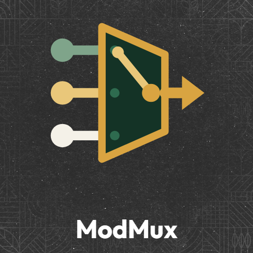

# ModHub upload: ModMux

What to enter in the GIANTS ModHub upload form for this mod. Each text box below has a copy button on GitHub.



**Mod Icon (512x512):** [`icon_512.png`](icon_512.png)

| Field | Value |
|-------|-------|
| Title English | ModMux |
| Title German | ModMux |
| Title French | ModMux |
| Version | `1` `0` `0` `2` |
| Author | DTM Mods, Fennell |
| Manufacturer | Lizard |
| Category 1 | Gameplay |
| Category 2 | Not Set |
| Category 3 | Not Set |

## Title English
```text
ModMux
```

## Title German
```text
ModMux
```

## Title French
```text
ModMux
```

## Description English
```text
Description: Many mods hook into the same parts of the game. When two of them change the same function, Farming Simulator lets the one loaded later decide, and depending on how it was written the other one may stop working without any message. ModMux shows you every place where your mods meet, explains in plain words what happens there, and lets you decide.
Hotkeys: none. ESC menu > ModMux page. The buttons along the bottom of the page follow the selected line.
GitHub: https://github.com/DTM-Mods/FS25_ModMux

Important: keep the zip named FS25_0_ModMux.zip. The game loads mods in the order of their names, and ModMux has to load before the mods it watches: it sees every hook as it is made. Where a mod puts in its own version of a function, ModMux finds out while you play whether the hooks under it still run.

Start on OVERVIEW: one line per area (mod fights, key clashes, errors, hints, performance, what waits for the next load), each with a verdict and a button that opens it.

Decide per function or for whole mods:
- Let one mod have its way on a function: only its hook stays there.
- Bring back a hook that another mod threw away, so both run (shared chain).
- Rank mods against each other, overall or only for one area (wheels, HUD, economy, weather, AI...). A higher mod runs last and has the final say.
- Four views: WHO BEATS WHOM (each pair of mods: which one overwrites or takes over the other), SIMPLE (the ranking), BY CATEGORY (area rankings), ADVANCED (each function with its complete chain of hooks).

More tabs:
- KEYS: keys and buttons that two mods (or a mod and the game) use in the same situation, so one press does two things. Read from your own key settings.
- ERRORS: one line per mod with its errors and warnings, including mods whose scripts stop while you play.
- LIVE: switches and values that mods hand to ModMux, applied at once.
- VEHICLE: readings from the vehicle you drive: speed, mass, damage, wear, engine temperature, grip and slip per wheel, the mods inside it.
- PERFORMANCE: milliseconds per frame for each mod against your target frame rate. Park a heavy mod's per-frame work without uninstalling it.
- REVIEW: hints with their reasons: two copies of one mod, mods cutting each other off, HUDs drawn on top of each other, pairs you listed as incompatible.
- PROFILES: store your decisions under a name and switch back later.

Safety:
- Decisions take effect when a savegame loads, never during play.
- Loading, saving and multiplayer sync are never touched.
- If a start doesn't finish, the next one runs with all ModMux interventions off. An empty file MODMUX_SAFE_MODE.txt in modSettings/FS25_ModMux does the same by hand.
- If a savegame comes up with its farms missing, saving is refused for that session.
- Writes only into modSettings/FS25_ModMux (settings, profiles, a start marker, what it saw while playing, the summary ModMux.log). No internet connection.

Console for dedicated servers: modMux, modMuxPick, modMuxPark, modMuxLevers, modMuxReport.
Single player and multiplayer. Every computer uses its own setup; on a server, the server's setup decides what the server runs.

Changelog 1.0.0.2:
- CONFLICTS opens on WHO BEATS WHOM: one line per pair of mods, saying which one overwrites, may overwrite, takes over or runs after the other, with buttons to let either one win.
- Easier to read: only what needs a look is shown first, every pair gets a verdict (Broken, Check, Probably fine, Fine) and a suggested fix, functions are named in words, and the tabs show how many things wait on them.
- New OVERVIEW tab: everything ModMux found on one page, with what waits for the next load and Undo all.
- New KEYS tab: keys and buttons used by two mods, or by a mod and the game, in the same situation, with a free key to move one to.
- New ERRORS tab: one line per mod with its errors and warnings, including scripts that stop while you play.
- The summary ModMux.log lists both.

Changelog 1.0.0.1:
- Works in the normal game: finds the mod behind each hook without the developer functions the game hides (1.0.0.0 found no conflicts there).
- The zip is now FS25_0_ModMux.zip so that it loads first. Delete FS25_ModMux.zip; the settings stay.
- Hooks under another mod's own version of a function are checked while you play.
```

## Description German
```text
Beschreibung: Viele Mods greifen in dieselben Teile des Spiels ein. Ändern zwei davon dieselbe Funktion, entscheidet in Farming Simulator der später geladene, und je nach Bauweise arbeitet der andere ohne jede Meldung nicht mehr. ModMux zeigt dir jede Stelle, an der sich deine Mods treffen, erklärt in einfachen Worten, was dort passiert, und lässt dich entscheiden.
Tastenkombinationen: keine. ESC-Menü > Seite ModMux. Die Tasten unten auf der Seite richten sich nach der gewählten Zeile.
GitHub: https://github.com/DTM-Mods/FS25_ModMux

Wichtig: Lass die Zip-Datei FS25_0_ModMux.zip heißen. Das Spiel lädt Mods in der Reihenfolge ihrer Namen, und ModMux muss vor den Mods laden, die es beobachtet: es sieht jeden Eingriff, während er gemacht wird. Setzt ein Mod eine eigene Version einer Funktion ein, findet ModMux beim Spielen heraus, ob die Eingriffe darunter noch laufen.

Beginne mit ÜBERSICHT: eine Zeile pro Bereich (Mod-Konflikte, Tastenkonflikte, Fehler, Hinweise, Leistung, was auf den nächsten Start wartet), jeweils mit Urteil und einer Taste, die ihn öffnet.

Entscheide pro Funktion oder für ganze Mods:
- Ein Mod setzt sich bei einer Funktion durch: nur sein Eingriff bleibt dort.
- Hole einen Eingriff zurück, den ein anderer Mod verworfen hat, damit beide laufen (gemeinsame Kette).
- Reihe Mods gegeneinander, allgemein oder nur für einen Bereich (Räder, HUD, Wirtschaft, Wetter, KI...). Ein höherer Mod läuft zuletzt und hat das letzte Wort.
- Vier Ansichten: WER GEGEN WEN (jedes Mod-Paar: welcher den anderen überschreibt oder übernimmt), EINFACH (der Rang), NACH BEREICH (Rang je Bereich), ERWEITERT (jede Funktion mit ihrer ganzen Kette).

Weitere Reiter:
- TASTEN: Tasten und Knöpfe, die zwei Mods (oder ein Mod und das Spiel) in derselben Lage benutzen, sodass ein Druck zwei Dinge auslöst. Aus deinen eigenen Tasteneinstellungen gelesen.
- FEHLER: eine Zeile pro Mod mit seinen Fehlern und Warnungen, auch Mods, deren Skripte während des Spiels abbrechen.
- LIVE: Schalter und Werte, die Mods an ModMux geben, gelten sofort.
- FAHRZEUG: Messwerte des Fahrzeugs, das du fährst: Geschwindigkeit, Masse, Schaden, Abnutzung, Motortemperatur, Haftung und Schlupf je Rad, die Mods darin.
- LEISTUNG: Millisekunden pro Bild für jeden Mod, gemessen an deiner Ziel-Bildrate. Parke die Arbeit eines schweren Mods pro Bild, ohne ihn zu deinstallieren.
- PRÜFEN: Hinweise mit Begründung: zwei Kopien eines Mods, Mods, die sich gegenseitig abschneiden, übereinander gezeichnete HUDs, als unvereinbar eingetragene Paare.
- PROFILE: speichere deine Entscheidungen unter einem Namen und wechsle später zurück.

Sicherheit:
- Entscheidungen greifen beim Laden eines Spielstands, nie während des Spiels.
- Laden, Speichern und Mehrspieler-Abgleich werden nie angefasst.
- Wird ein Start nicht fertig, sind beim nächsten alle ModMux-Eingriffe ausgeschaltet. Eine leere Datei MODMUX_SAFE_MODE.txt in modSettings/FS25_ModMux macht das von Hand.
- Kommt ein Spielstand ohne seine Höfe hoch, wird in dieser Sitzung nicht gespeichert.
- Schreibt nur nach modSettings/FS25_ModMux (Einstellungen, Profile, eine Startmarke, was es beim Spielen gesehen hat, die Übersicht ModMux.log). Keine Internetverbindung.

Konsole für dedizierte Server: modMux, modMuxPick, modMuxPark, modMuxLevers, modMuxReport.
Einzel- und Mehrspieler. Jeder Rechner nutzt seine eigenen Einstellungen; auf einem Server entscheiden die des Servers, was der Server ausführt.

Changelog 1.0.0.2:
- KONFLIKTE öffnet mit WER GEGEN WEN: eine Zeile pro Mod-Paar, welcher den anderen überschreibt, evtl. überschreibt, übernimmt oder nach ihm läuft, mit Tasten, um einen gewinnen zu lassen.
- Leichter zu lesen: zuerst nur, was angesehen werden sollte, jedes Paar bekommt ein Urteil (Kaputt, Prüfen, Wohl in Ordnung, In Ordnung) und einen Vorschlag, Funktionen stehen in Worten, und die Reiter zeigen, wie viel auf sie wartet.
- Neuer Reiter ÜBERSICHT: alles, was ModMux gefunden hat, auf einer Seite, mit dem, was auf den nächsten Start wartet, und Alles zurücknehmen.
- Neuer Reiter TASTEN: Tasten und Knöpfe, die zwei Mods oder ein Mod und das Spiel in derselben Lage benutzen, mit einer freien Taste zum Ausweichen.
- Neuer Reiter FEHLER: eine Zeile pro Mod mit seinen Fehlern und Warnungen, auch Skripte, die während des Spiels abbrechen.
- Die Übersicht ModMux.log listet beides.

Changelog 1.0.0.1:
- Funktioniert im normalen Spiel: findet den Mod hinter jedem Eingriff ohne die Entwicklerfunktionen, die das Spiel verbirgt (1.0.0.0 fand dort keine Konflikte).
- Die Zip-Datei heißt jetzt FS25_0_ModMux.zip, damit sie zuerst lädt. Lösche FS25_ModMux.zip; die Einstellungen bleiben.
- Eingriffe unter der eigenen Version eines anderen Mods werden beim Spielen geprüft.
```

## Description French
```text
Description : Beaucoup de mods interviennent dans les mêmes parties du jeu. Quand deux d'entre eux modifient la même fonction, Farming Simulator laisse décider celui chargé en dernier, et selon sa conception l'autre peut cesser de fonctionner sans aucun message. ModMux vous montre chaque endroit où vos mods se croisent, explique simplement ce qui s'y passe et vous laisse décider.
Raccourcis : aucun. Menu Échap > page ModMux. Les boutons en bas de la page suivent la ligne sélectionnée.
GitHub: https://github.com/DTM-Mods/FS25_ModMux

Commencez par OVERVIEW : une ligne par domaine (conflits de mods, conflits de touches, erreurs, conseils, performance, ce qui attend le prochain chargement), chacune avec un verdict et un bouton qui l'ouvre.

Décidez par fonction ou pour des mods entiers :
- Donner raison à un mod sur une fonction : seul son crochet y reste.
- Rétablir un crochet qu'un autre mod a écarté, pour que les deux tournent (chaîne partagée).
- Classer les mods entre eux, globalement ou pour un seul domaine (roues, HUD, économie, météo, IA...). Un mod placé plus haut passe en dernier et a le dernier mot.
- Quatre vues : WHO BEATS WHOM (chaque paire de mods : lequel écrase ou reprend l'autre), SIMPLE (le classement), BY CATEGORY (classements par domaine), ADVANCED (chaque fonction avec sa chaîne complète).

Autres onglets :
- KEYS : touches et boutons utilisés par deux mods (ou un mod et le jeu) dans la même situation, si bien qu'un appui fait deux choses. Lu dans vos propres réglages de touches.
- ERRORS : erreurs et avertissements triés par mod, y compris les mods dont les scripts s'arrêtent pendant le jeu.
- LIVE : interrupteurs et valeurs que les mods confient à ModMux, appliqués aussitôt.
- VEHICLE : mesures du véhicule que vous conduisez : vitesse, masse, dégâts, usure, température moteur, adhérence et patinage par roue, les mods qu'il contient.
- PERFORMANCE : millisecondes par image pour chaque mod, comparées à votre fréquence d'images visée. Mettez en pause le travail par image d'un mod lourd sans le désinstaller.
- REVIEW : indices avec leurs raisons : deux copies d'un même mod, mods qui se coupent l'un l'autre, HUD dessinés l'un sur l'autre, paires déclarées incompatibles.
- PROFILES : enregistrez vos décisions sous un nom et revenez-y plus tard.

Sécurité :
- Les décisions s'appliquent au chargement d'une partie, jamais pendant le jeu.
- Le chargement, la sauvegarde et la synchronisation multijoueur ne sont jamais touchés.
- Si un démarrage n'aboutit pas, le suivant tourne avec toutes les interventions de ModMux désactivées. Un fichier vide MODMUX_SAFE_MODE.txt dans modSettings/FS25_ModMux fait de même à la main.
- Si une partie se charge sans ses fermes, la sauvegarde est refusée pour cette session.
- N'écrit que dans modSettings/FS25_ModMux (réglages, profils, un marqueur de démarrage, le résumé ModMux.log). Aucune connexion internet.

Console pour serveurs dédiés : modMux, modMuxPick, modMuxPark, modMuxLevers, modMuxReport.
Solo et multijoueur. Chaque ordinateur utilise ses propres réglages ; sur un serveur, ceux du serveur décident de ce qu'il exécute.

Changelog 1.0.0.2 :
- Nouvel onglet OVERVIEW : tout ce que ModMux a trouvé sur une page, avec ce qui attend le prochain chargement et Undo all.
- CONFLICTS s'ouvre sur WHO BEATS WHOM : une ligne par paire de mods, lequel écrase, écrase peut-être, reprend ou passe après l'autre, avec des boutons pour faire gagner l'un ou l'autre.
- Plus lisible : d'abord seulement ce qui mérite un regard, un verdict et une solution proposée par paire, des noms de fonctions en mots, et des compteurs sur les onglets.
- Nouvel onglet KEYS : touches et boutons utilisés par deux mods, ou par un mod et le jeu, dans la même situation.
- Nouvel onglet ERRORS : erreurs et avertissements de vos mods triés par mod, y compris les scripts qui s'arrêtent pendant le jeu.
- Le résumé ModMux.log liste les deux.
```

## Before uploading

- The mod has no French: the in-game texts exist in English and German only, and modDesc.xml has only English and
  German descriptions. The French text here does not add translations to the mod.
- It ships console commands (`modMux`, `modMuxReport`, `modMuxPick`, `modMuxPark`, `modMuxLevers`). They are how a
  dedicated server is set up; your decision whether they stay in a ModHub build.
- It writes files to `modSettings/FS25_ModMux/` (settings, profiles, a start marker, `ModMux.log`). ModHub allows
  modSettings, but say so in the description if GIANTS asks.
- It reads other mods' hooks with Lua's `debug` library and can rebuild them (on the next load, at the player's
  request). Expect GIANTS to look at that closely; the description says what it does.
- NOT tested in game yet (1.0.0.0 passed the offline tests and TestRunner only). Test it in single player and on the
  server before uploading.
- Screenshots: none yet. ModHub needs at least 3 unedited in-game shots at 1600x900, the first without UI. The
  pictures in `../previews/` are mock-ups and must NOT be uploaded.
